# Test 1: Monitoring Stack

Logging and metrics monitoring for a Kubernetes cluster, built on a local 3-node
**kind** cluster to simulate the team's AKS environment.

| | Choice |
|---|---|
| Logs | **Grafana Alloy** (shipper, DaemonSet) → **Loki** (storage) → **Grafana** |
| Metrics | **kube-prometheus-stack**: Prometheus, Alertmanager, node-exporter, kube-state-metrics, Grafana |
| Alerts | `PrometheusRule` resources (alerts as code) |
| Dashboards | JSON files loaded via ConfigMaps (dashboards as code) |
| Environment | kind v0.33.0, Kubernetes v1.37.0, on WSL2 (Ubuntu) + Docker Desktop |

Everything in this folder rebuilds with one command: `./test-1-monitoring/install.sh`.

---

## Part A: Tool Selection

### Logging: Grafana Alloy + Loki + Grafana

**Why Loki instead of Elasticsearch (EFK/ELK):**
- **Resource usage.** Loki only indexes labels (namespace, pod, container, node), not the
  full text of every log line. Elasticsearch indexes everything and runs on the JVM, which
  typically needs several GB of memory per node. For a team starting from zero monitoring,
  Loki is far cheaper to run.
- **Maintenance.** Elasticsearch clusters need shard management, index lifecycle policies
  and JVM tuning. Loki in single-binary mode is one pod; in production it scales out and
  stores data in cheap object storage (Azure Blob Storage on AKS).
- **One UI.** Logs and metrics live in the same Grafana, so an engineer can go from a CPU
  spike to the logs for that pod without switching tools.

**Why Alloy instead of Promtail:** the brief lists Promtail as an example, but Grafana has
deprecated Promtail and it has reached end of life, with **Grafana Alloy** as its official
replacement. Choosing a tool that is no longer maintained would create work for the team
later, so I chose Alloy. It runs as a DaemonSet and does the same job: it discovers pods on
its node, tails their log files from `/var/log/pods`, attaches Kubernetes labels and pushes
to Loki.

### Metrics: kube-prometheus-stack (Prometheus + Grafana)

- **One Helm chart** installs Prometheus, Alertmanager, Grafana, node-exporter (node CPU,
  memory, disk) and kube-state-metrics (pod phases, restarts, container states). That covers
  every metric the brief asks for.
- **Prometheus Operator** lets alerts be defined as Kubernetes resources (`PrometheusRule`),
  so they are version-controlled and reviewed like any other code.
- **Industry standard.** PromQL, exporters and community knowledge are widely available,
  which matters for a team maintaining this long term.

### Alternatives I considered

| Option | Why I didn't choose it here |
|---|---|
| **Azure Monitor Container Insights** | Very low maintenance and native to AKS, but log ingestion is billed per GB, which grows quickly with chatty apps. Queries use KQL, a separate skill from PromQL. A good fit if the team wants zero self-hosting. |
| **Azure Monitor managed Prometheus + Azure Managed Grafana** | A strong production option on AKS (see "Production improvements"). It uses the same PromQL, so the alerts and dashboards in this repo would carry over almost unchanged. Not possible to run locally on kind. |
| **Datadog** | Excellent product, but per-host and per-GB pricing is high for a team just starting out, and it adds vendor lock-in. |
| **EFK (Fluentd/Fluent Bit + Elasticsearch + Kibana)** | Powerful full-text search, but much heavier to run and maintain (see above). |

---

## Part B: Setup

### Environment

I used a local **kind** cluster (1 control-plane + 2 worker nodes) instead of AKS, to keep
the work free and reproducible. Three nodes were chosen deliberately so the log-shipper
DaemonSet can be seen running on every node.

| Component | Version |
|---|---|
| kind / Kubernetes | v0.33.0 / v1.37.0 |
| Helm | v3.22.0 |
| kube-prometheus-stack chart | 92.6.0 |
| Loki chart | 7.3.0 (single-binary mode) |
| Alloy chart / app | 1.13.1 / v1.20.1 |

### Architecture

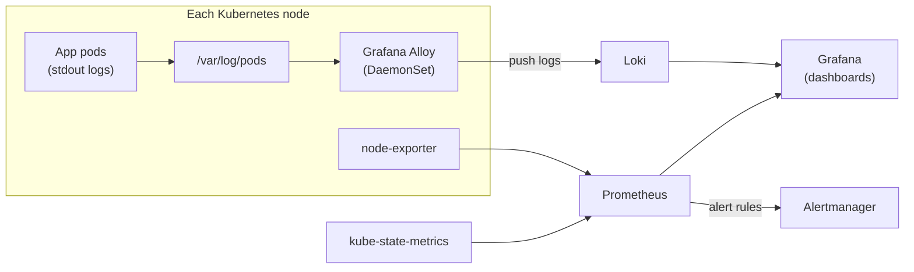

### Folder layout

```text
test-1-monitoring/
├── install.sh                  # rebuilds everything below, in order
├── config/
│   ├── kind-cluster.yaml       # 3-node kind cluster
│   ├── loki-values.yaml        # Loki single-binary, filesystem storage
│   ├── kube-prometheus-stack-values.yaml
│   ├── alloy-values.yaml       # Alloy as a DaemonSet (incl. control-plane node)
│   ├── alloy-config.alloy      # log discovery, labelling and shipping pipeline
│   └── test-workloads.yaml     # demo apps that generate logs + a crash-looping pod
├── dashboards/                 # Grafana dashboards as JSON + loader script
├── alerts/                     # PrometheusRule, alert test workloads, screenshots
└── screenshots/
```

### How to run it

**Prerequisites:** Docker, kind, kubectl, Helm.

```bash
# From the repo root
./test-1-monitoring/install.sh
```

The script creates the cluster, installs Loki, kube-prometheus-stack and Alloy, applies the
alert rules, loads the dashboards and deploys the test workloads. It prints the Grafana
admin password at the end.

**Access the UIs:**

```bash
kubectl port-forward -n monitoring svc/kube-prometheus-stack-grafana 3000:80        # http://localhost:3000
kubectl port-forward -n monitoring svc/kube-prometheus-stack-prometheus 9090:9090   # http://localhost:9090
```

**Clean up:** `kind delete cluster --name monitoring`

### Notable configuration decisions

- **No secrets in the repo.** The Grafana admin password is generated randomly at install
  time and stored in a Kubernetes Secret, which the Helm values reference by name.
- **Alloy runs on the control-plane node too** (via a toleration), so logs are collected
  from *all* pods, including system components.
- **Each Alloy pod only discovers pods on its own node** (a `spec.nodeName` field selector),
  so logs are never shipped twice.
- **Disabled scraping of controller-manager, scheduler, etcd and kube-proxy.** On kind these
  listen on `127.0.0.1` inside the node and cannot be scraped, which causes false
  "target down" alerts. On AKS they are managed by Azure and are not scrapeable either, so
  this setting matches the real environment.
- **Test workloads** (`demo` and `shop` namespaces) log at info/warn/error levels in
  `logfmt` format, so the dashboards have realistic data to show, plus a deliberately
  broken `crashy` deployment to test the CrashLoopBackOff alert.

### Verification

| Check | Screenshot |
|---|---|
| Alloy DaemonSet running on all 3 nodes | 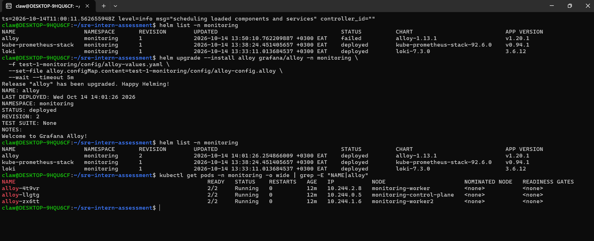 |
| Container logs visible in Grafana (Loki) | 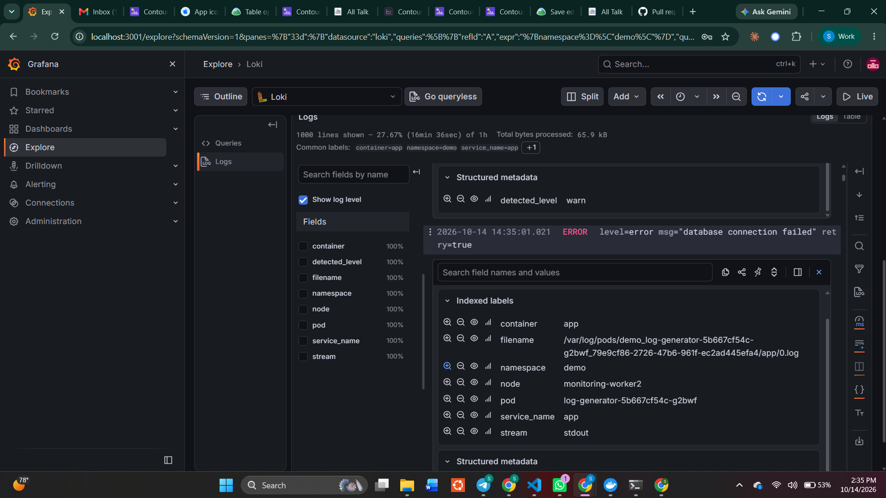 |
| Cluster CPU, memory and pod count queries | 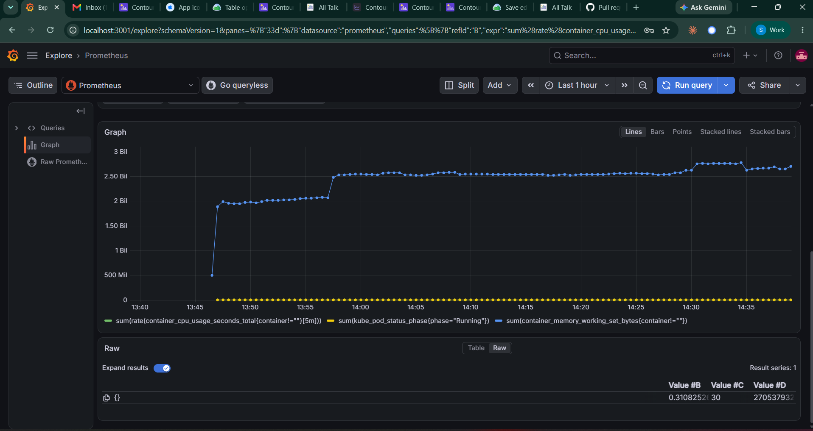 |

---

## Part C: Dashboards

All dashboards are JSON files in [`dashboards/`](dashboards/), loaded automatically by
the Grafana sidecar. Because they are provisioned, changes made in the Grafana UI cannot
be saved. The repo is the single source of truth, and dashboards are changed by editing
the JSON and re-running `dashboards/load-dashboards.sh`.

### Dashboard 1: Cluster Health Overview

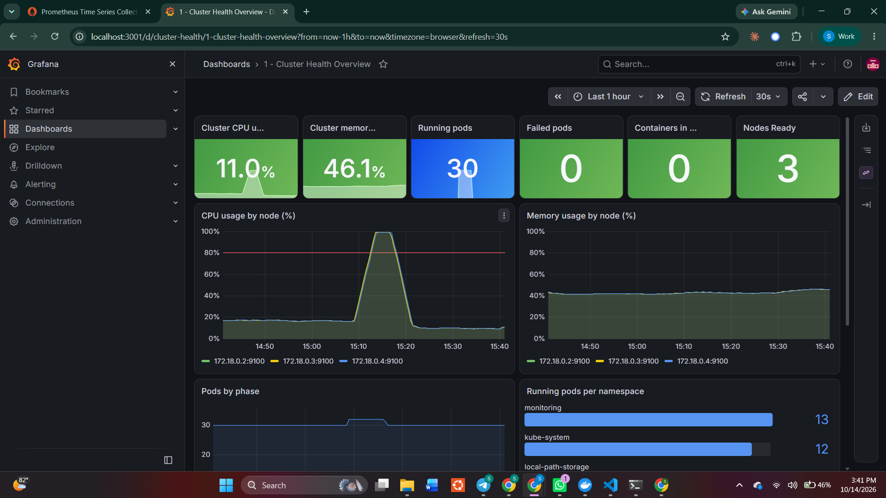

- **Top row (at-a-glance stats):** cluster CPU %, cluster memory %, running pods,
  failed pods, containers in CrashLoopBackOff, nodes Ready. Colour thresholds turn
  them orange/red so problems stand out.
- **CPU and memory by node** over time, with an 80% line on the CPU graph matching the alert.
- **Pods by phase** over time, and **running pods per namespace**.
- **Table of pods not running** (Failed, Pending, Unknown), so you can see *which* pods.

*Why the CrashLoopBackOff stat:* a crash-looping pod reports its phase as `Running`, not
`Failed`. A "failed pods" count on its own would show 0 while a pod is crashing every
minute, which is misleading on a health dashboard.

### Dashboard 2: Application Logs

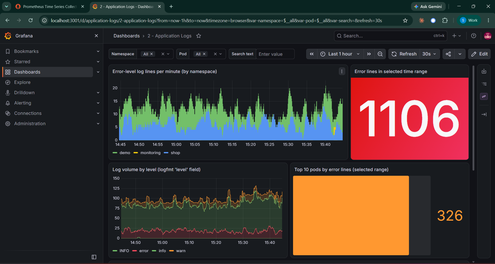

- **Filters:** Namespace and Pod dropdowns (multi-select, Pod list updates based on the
  chosen namespace), plus a free-text **Search** box.
- **Error-level log lines per minute**, by namespace (the panel required by the brief).
- **Total error lines** in the selected time range.
- **Log volume by level** (info / warn / error, colour-coded), parsed from the `level` field.
- **Top 10 pods by error count**, to find the noisiest source quickly.
- **Log stream** filtered by all of the above.

*Design notes:*
- The "All" option uses the regex `.+` rather than `.*`. Loki rejects queries where every
  label matcher could match an empty string, so `.*` would break the dashboard.
- The error count uses a case-insensitive match on `error`. This works for any log format,
  but can over-count (for example a line saying "0 errors"). With structured JSON logs,
  filtering on a parsed `level` field would be more accurate.

### Dashboard 3: On-call Triage (my choice)

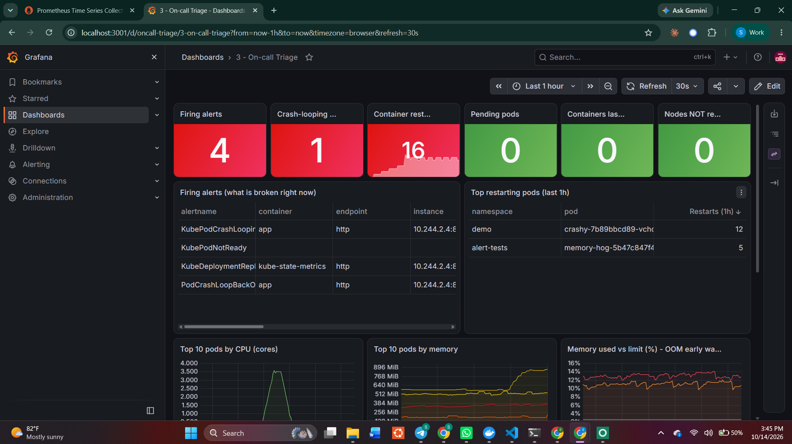

**Why I chose it:** the other two dashboards describe the cluster in general. When someone
is paged at 3am, they need one screen that answers *"what is broken right now, and where
do I look first?"* This dashboard is ordered to follow that investigation:

1. **Is anything wrong?** Firing alerts, crash-looping containers, restarts in the last
   hour, pending pods, OOMKilled containers, nodes not ready. Everything green means
   the problem is probably outside the cluster.
2. **What exactly?** A table of firing alerts (with namespace/pod), and the top
   restarting pods.
3. **Is it resources?** Top 10 pods by CPU and by memory, plus **memory used vs limit (%)**
   with a 90% line. Pods approaching their limit are about to be OOMKilled, so this gives
   early warning *before* the alert fires.
4. **What do the logs say?** Recent error lines from every namespace.

---

## Part C: Alerts

Defined in [`alerts/prometheus-rules.yaml`](alerts/prometheus-rules.yaml) as a
`PrometheusRule`, which the Prometheus Operator loads automatically.

| Alert | Condition | Severity | Why |
|---|---|---|---|
| **PodCrashLoopBackOff** | Container in CrashLoopBackOff for > 5 min | critical | Required by the brief. The app is not serving and will not recover on its own. |
| **NodeHighCPUUsage** | Node CPU > 80% for > 3 min | warning | Required by the brief. Sustained high CPU causes throttling and slow responses for every pod on the node. |
| **ContainerOOMKilled** *(my choice)* | Container restarted in the last 10 min **and** its last termination reason was OOMKilled | warning | See below. |

**Why ContainerOOMKilled:** OOMKills are one of the most common failures on Kubernetes, and
one of the quietest. The kernel kills the container, Kubernetes restarts it, and the pod
looks `Running` again, so nobody notices until users see errors or lost requests. It almost
always means memory limits are set too low or the app has a memory leak, both of which
someone needs to act on. Each alert's description includes the `kubectl` command to start
investigating.

**Implementation detail (CrashLoopBackOff):** every time a crash-looping container restarts,
it briefly leaves the "waiting" state, so the metric flickers between 1 and 0. A plain
`== 1` check would keep resetting the 5-minute timer and might never fire. I used
`max_over_time(...[2m])` to smooth over those gaps. (kube-prometheus-stack also ships its
own `KubePodCrashLooping` alert, but it waits 15 minutes; mine meets the brief's 5-minute
requirement.)

### Testing the alerts

I proved each alert fires using test workloads in a separate `alert-tests` namespace
([`alerts/alert-test-workloads.yaml`](alerts/alert-test-workloads.yaml)), deleted afterwards:

- **CrashLoopBackOff:** the `crashy` deployment exits immediately on start.
- **Node CPU:** a pod running one busy loop per CPU core.
- **OOMKilled:** a pod with a 50Mi memory limit running `tail /dev/zero`, which allocates
  memory until the kernel kills it.

| | Screenshot |
|---|---|
| Rules loaded | 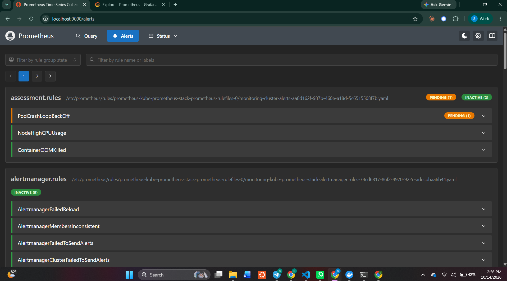 |
| CrashLoopBackOff firing | 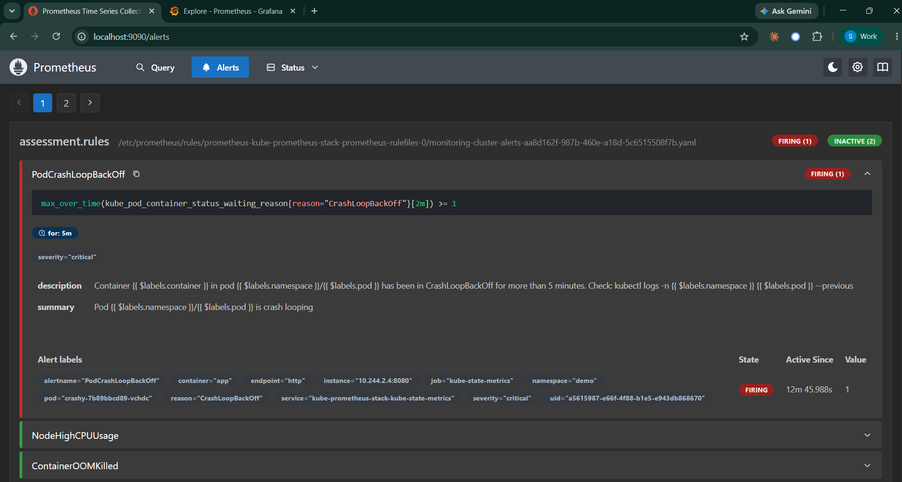 |
| Node CPU firing | 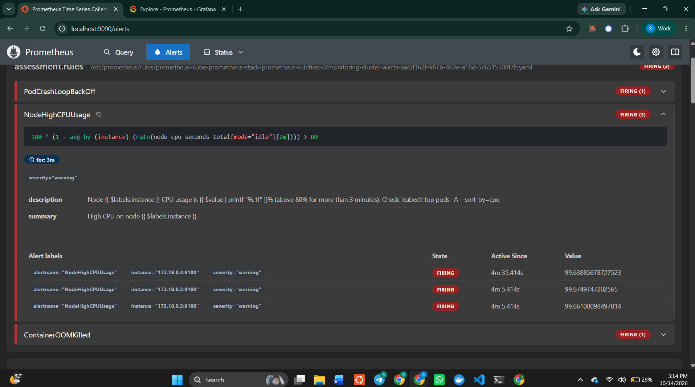 |
| OOMKilled firing | 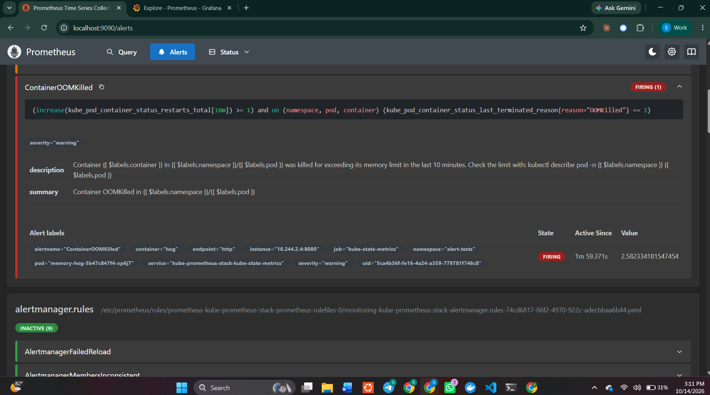 |

**Note on the CPU test:** all three nodes alerted, not just one. On kind, every "node" is a
container sharing my laptop's CPU, so node-exporter on each one reports the same total.
On AKS, each node is a separate VM and only the busy node would alert.

---

## Problems I hit (and how I solved them)

- **Alloy Helm install timed out.** `helm install --wait` gave up after 5 minutes because
  the image download was slow on my connection (about 1.5 MB/s, pulled once per node).
  I checked with `kubectl get pods` and `kubectl logs`: all three pods were healthy and
  already tailing log files. The release was only marked `failed` because of the timeout,
  so I re-ran `helm upgrade --install` (images now cached), which marked it `deployed`.
  I raised the timeout to 15 minutes in `install.sh` because of this.
- **Prometheus showed "No matching rules"** for my group: the search box filters by alert
  name, not group name. Clearing the filter showed all three rules.
- **Windows `Zone.Identifier` files got committed** when saving screenshots from Windows
  into the WSL folder. I removed them and added them to `.gitignore`.

---

## What I would improve for production (on AKS)

- **Loki storage:** use **Azure Blob Storage** instead of the pod's filesystem, with
  **AKS Workload Identity** for access (no storage keys in config), and set retention.
- **Consider managed services:** **Azure Monitor managed Prometheus + Azure Managed Grafana**
  removes the work of running and upgrading Prometheus and Grafana. The PromQL in these
  alerts and dashboards would carry over.
- **Alert routing:** configure Alertmanager to send to Microsoft Teams, Slack or PagerDuty,
  with critical alerts paging and warnings going to a channel. Right now alerts only
  appear in the UI.
- **High availability:** 2+ Prometheus replicas (or Thanos / managed Prometheus for
  long-term storage), and Loki in simple-scalable mode.
- **Secure access:** expose Grafana through an Ingress with TLS and **Microsoft Entra ID**
  single sign-on instead of port-forwarding and a shared admin password.
- **Runbooks:** add a `runbook_url` annotation to each alert linking to a page with
  investigation and fix steps.
- **Better logs and alerts:** structured JSON logging for accurate level filtering, and
  SLO-based alerts (error rate, latency) on the applications themselves, not just
  infrastructure symptoms.
- **GitOps:** deploy this stack with Flux (built into AKS as the GitOps extension) or
  Argo CD, instead of a shell script.

---

## Assumptions

- A local kind cluster is an acceptable stand-in for AKS (the brief allows this). I've
  noted every place where behaviour differs from AKS.
- The test workloads stand in for the team's real applications.
