# Test 2: Infrastructure Automation

Provisions a small Azure environment with **Terraform** and configures it with **Ansible**.
I deployed it for real on Azure, tested it, took screenshots, and destroyed it afterwards.

| | |
|---|---|
| Cloud | Microsoft Azure, region **South Africa North** (closest to Nairobi) |
| Provisioning | Terraform 1.16 with the `azurerm` provider (v4) |
| Configuration | Ansible (core 2.21) |
| Resources | 13 (VNet, 2 subnets, 2 NSGs, 2 VMs, public IP, NICs) |

---

## Part A: Tool Choice

### Terraform + Ansible

I used both, because each is best at a different job:

- **Terraform provisions the infrastructure.** It is declarative and keeps a state file,
  so it knows what exists, shows a plan before changing anything, and can destroy
  everything cleanly. That is ideal for networks, NSGs and VMs.
- **Ansible configures what runs on the VMs.** It is idempotent (running it twice changes
  nothing the second time, which I tested), agentless (only needs SSH), and readable.
  It is better suited than Terraform for installing packages and editing files.

**Why not Terraform alone?** Terraform can pass a startup script to a VM (`custom_data`),
but it only runs once at first boot, is hard to debug, and Terraform cannot see whether
it succeeded. Ansible can be re-run at any time and reports exactly what changed.

**Why not Bash?** Bash scripts are not idempotent by default and do not track state,
so re-running them is risky.

### How secrets and sensitive values are handled

- **No credentials in code.** Terraform authenticates with my `az login` session. The
  subscription ID comes from the `ARM_SUBSCRIPTION_ID` environment variable.
- **My IP address** (used for the SSH rule) is passed as `TF_VAR_my_ip` and the variable is
  marked `sensitive = true`, so it shows as `(sensitive value)` in `plan-output.txt`.
- **SSH keys only.** Password login is disabled on both VMs. Only the *public* key is
  referenced; the private key never leaves my machine.
- **Git-ignored:** `*.tfvars`, `*.tfstate`, `.terraform/`, and Ansible's generated
  `inventory.ini` (it contains live IPs). A `terraform.tfvars.example` shows the format.
- Before committing, I checked `plan-output.txt` did not contain my IP or subscription ID.

---

## Part B: What It Provisions

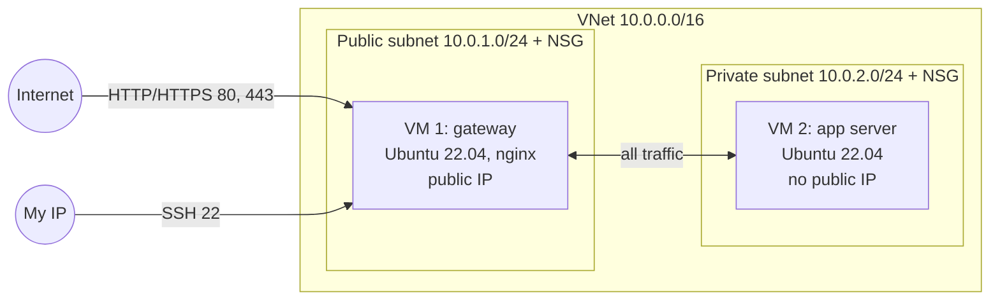

| Resource | Details |
|---|---|
| Resource group | `sre-assess-rg` (everything lives here, so cleanup is one command) |
| Virtual network | `10.0.0.0/16` |
| Subnets | Public `10.0.1.0/24`, private `10.0.2.0/24` |
| VM 1 (gateway) | Ubuntu 22.04, `Standard_B2ats_v2`, Standard SKU static public IP |
| VM 2 (app server) | Ubuntu 22.04, `Standard_B2ats_v2`, **no public IP** |
| NSGs | One per subnet (rules below) |

### Firewall rules

| NSG | Priority | Rule | Source | Ports |
|---|---|---|---|---|
| Public | 100 | Allow SSH | **My IP only** | 22 |
| Public | 110 | Allow HTTP/HTTPS | Internet | 80, 443 |
| Public | 120 | Allow all | Private subnet | all |
| Public | 4096 | **Deny all other inbound** | any | all |
| Private | 100 | Allow all | Public subnet | all |
| Private | 4096 | **Deny all other inbound** | any | all |

**Why the explicit deny rules:** Azure adds default rules at priority 65000+, including
`AllowVnetInBound`, which allows *all* traffic from inside the VNet. Without my deny rule
at 4096, VM 2 would accept traffic from anywhere in the VNet, not just from VM 1's subnet.

### Ansible configuration

The playbook [`ansible/site.yml`](ansible/site.yml):

- **VM 1:** sets the hostname to `gateway-vm1`, installs **nginx**, deploys a landing
  page, enables nginx on boot, and checks the page responds.
- **VM 2:** sets the hostname to `app-vm2`. This is done *through* VM 1 (SSH jump host),
  which proves the private VM is reachable only via the gateway.

The inventory is generated from Terraform outputs by
[`ansible/generate-inventory.sh`](ansible/generate-inventory.sh), so no IPs are typed by hand.

---

## How to Run

**Prerequisites:** Terraform, Azure CLI, Ansible, an SSH key at `~/.ssh/id_ed25519`.

```bash
# 1. Authenticate and set sensitive values as environment variables
az login --use-device-code
export ARM_SUBSCRIPTION_ID=$(az account show --query id -o tsv)
export TF_VAR_my_ip=$(curl -s -4 https://ifconfig.me)

# 2. Provision
cd test-2-automation/terraform
terraform init
terraform plan
terraform apply

# 3. Configure
cd ../ansible
./generate-inventory.sh
ansible all -m ping
ansible-playbook site.yml

# 4. Test
curl http://$(terraform -chdir=../terraform output -raw vm1_public_ip)

# 5. Clean up
cd ../terraform
terraform destroy
```

---

## Evidence

| Step | Screenshot |
|---|---|
| `terraform apply` complete | 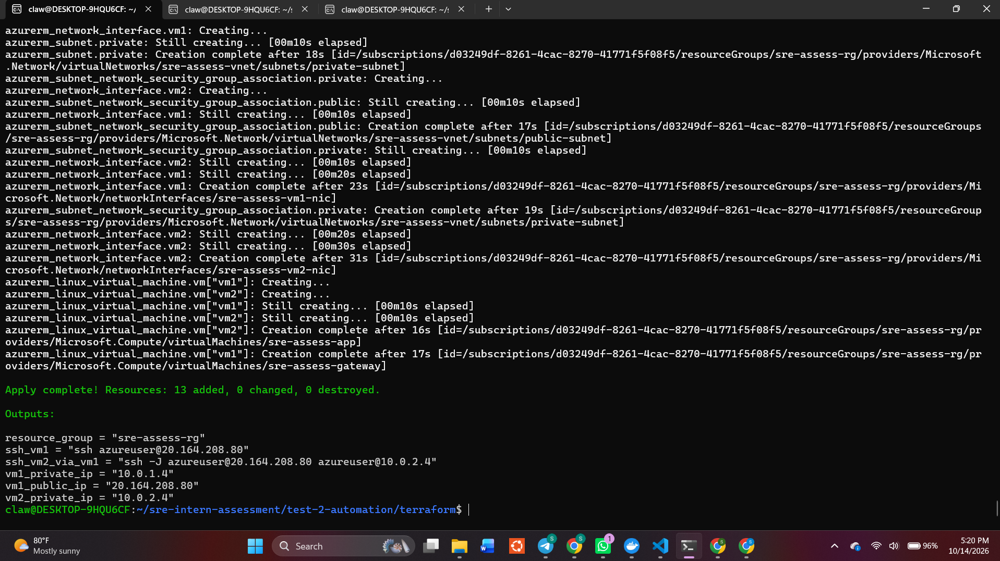 |
| Resource group in the portal | 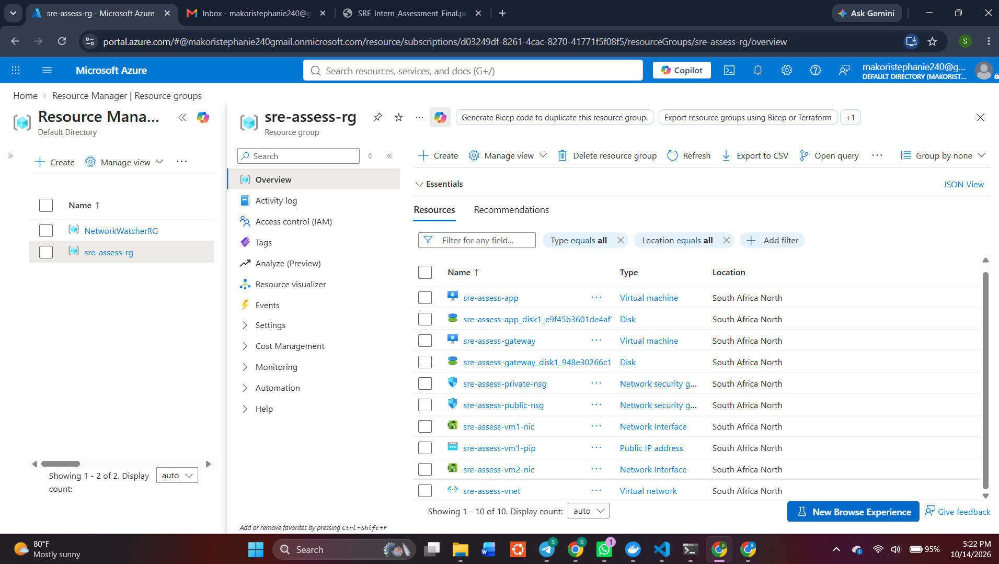 |
| VM 1 with public IP, VM 2 private only | 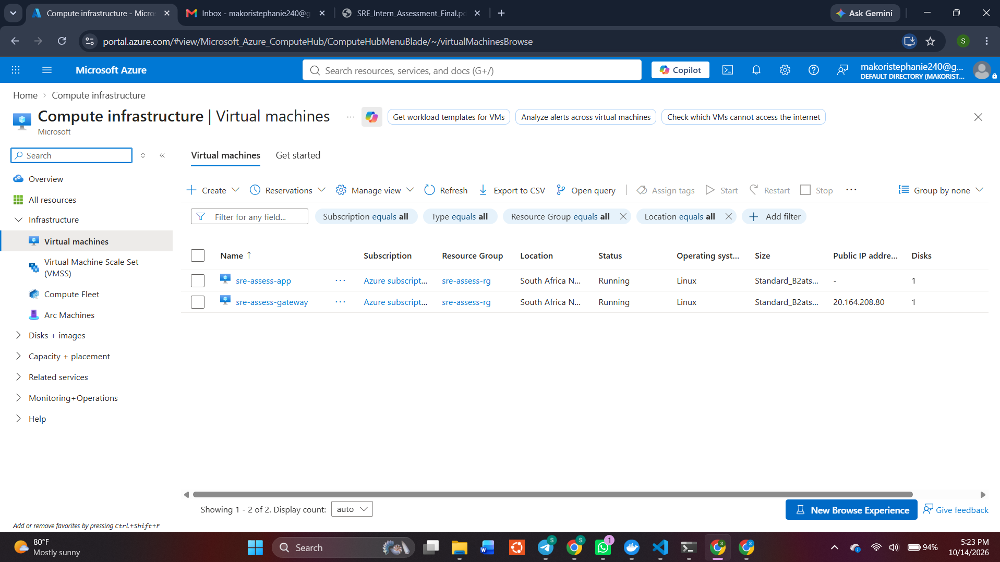 |
| NSG inbound rules | 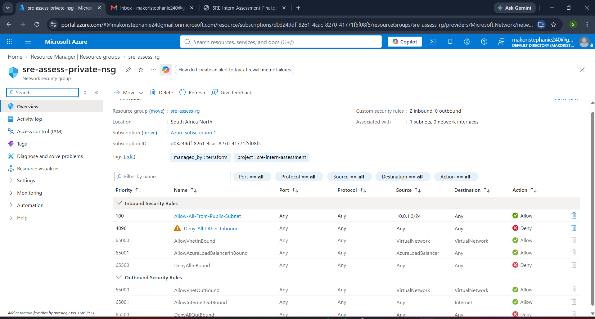 |
| Ansible playbook run (`failed=0`) | 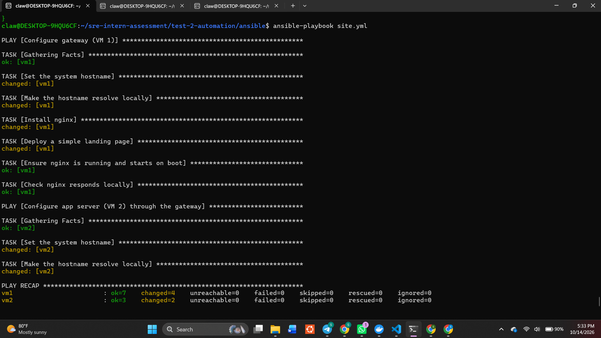 |
| Second run: `changed=0` (idempotent) | 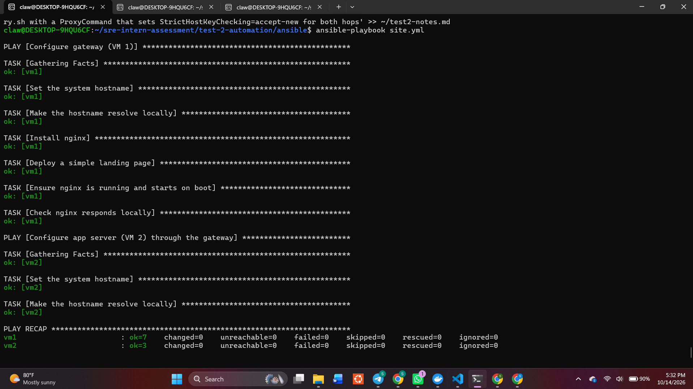 |
| nginx reachable from the internet | 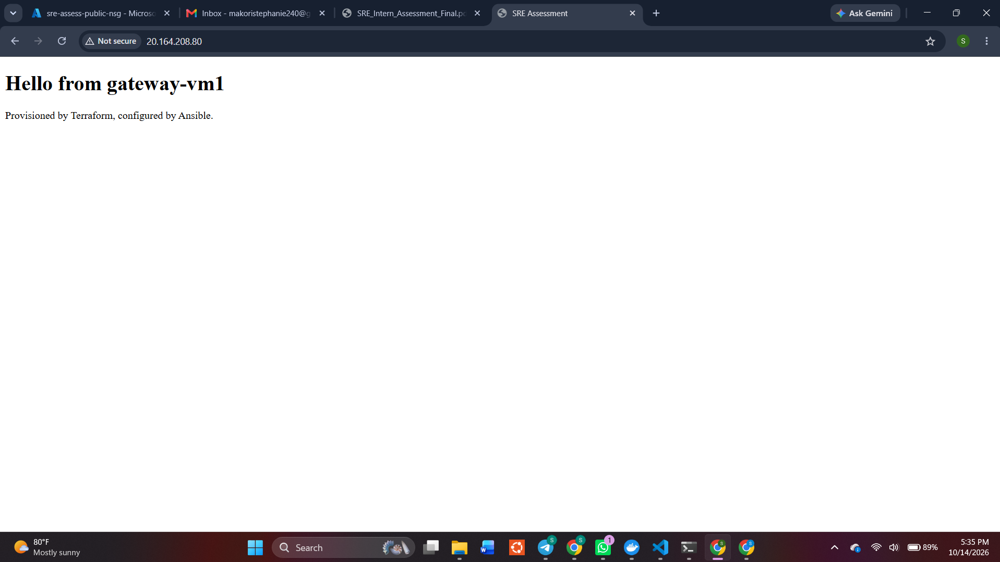 |
| SSH to VM 2 through VM 1 | 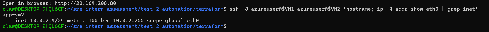 |
| NSG rules verified | 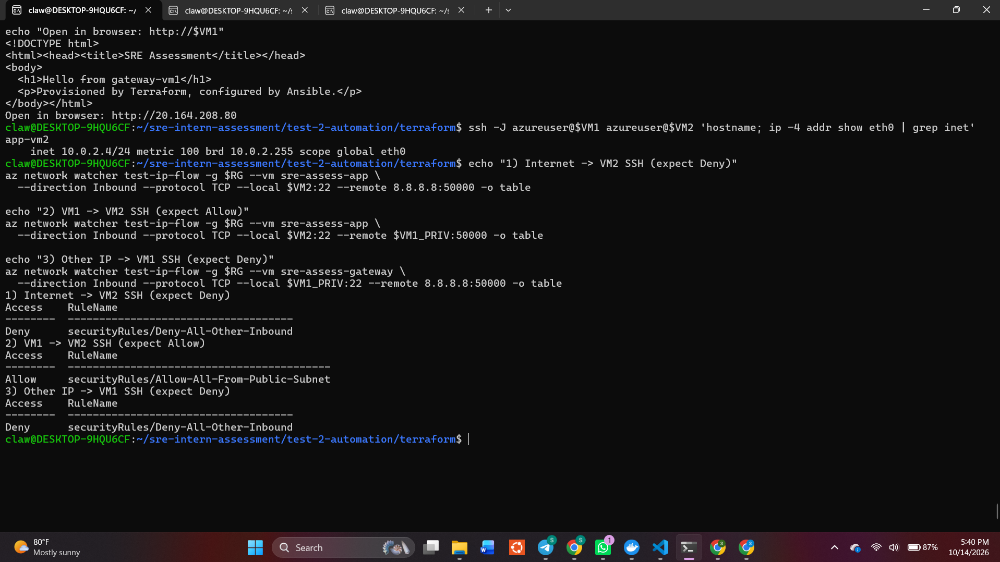 |
| `terraform destroy` complete | 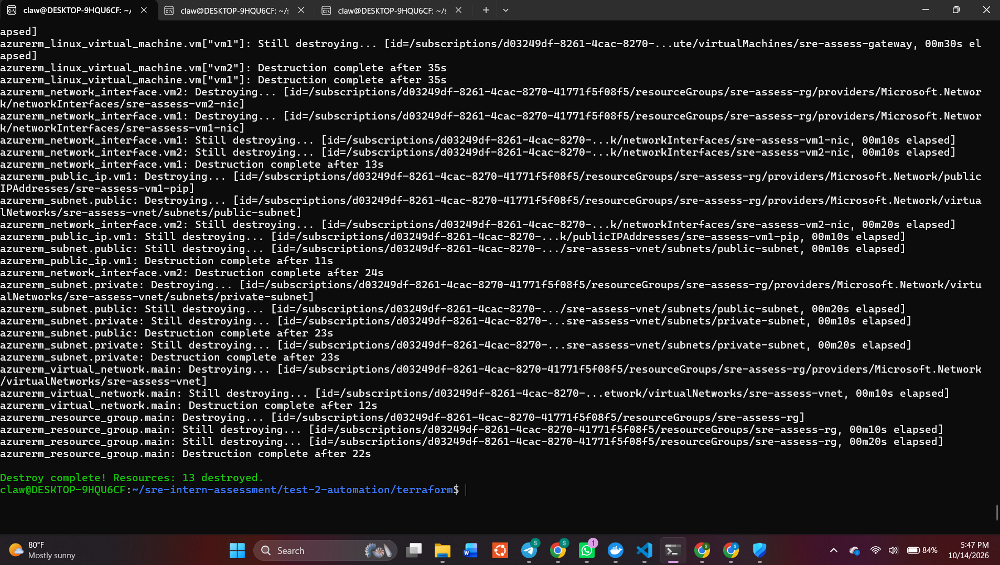 |

**Testing the deny rules:** VM 2 has no public IP, so it cannot be attacked from outside to
test the firewall. Instead I used **Azure Network Watcher IP flow verify**, which asks Azure
which rule would handle a given packet:

| Test | Result | Rule matched |
|---|---|---|
| Internet → VM 2, SSH | Deny | `Deny-All-Other-Inbound` |
| VM 1 → VM 2, SSH | Allow | `Allow-All-From-Public-Subnet` |
| Other IP → VM 1, SSH | Deny | `Deny-All-Other-Inbound` |

---

## Decisions and Azure Notes

- **VM size:** `Standard_B1s` was not offered in South Africa North for my subscription
  (`az vm list-skus` returned nothing), so I used `Standard_B2ats_v2`, the smallest
  available size.
- **Standard SKU public IP:** Basic SKU public IPs are retired in Azure.
- **`for_each` for the VMs:** both VMs share one resource block, avoiding duplicated code.
- **No packages installed on VM 2:** new Azure VNets no longer give VMs default outbound
  internet access, so VM 2 cannot reach package mirrors without a NAT Gateway. Setting the
  hostname needs no internet, so it still proves Ansible works through the gateway.
- **`host_key_checking = False`** in Ansible, because these VMs are short-lived and get new
  host keys each time. In production I would manage `known_hosts` instead.

## Problems I Hit

- **Ansible reached VM 1 but not VM 2 at first.** The SSH connection through the jump host
  stalled on an unanswered host-key prompt. I tested the jump by hand with `ssh -J`, which
  proved the network path and NSG rules worked and saved the host key. I then made the fix
  permanent in `generate-inventory.sh` with a `ProxyCommand` that sets
  `StrictHostKeyChecking=accept-new` for the jump connection.
- **VM size unavailable** in my region (see above).

---

## What I Would Add in Production

- **Remote state:** store Terraform state in an **Azure Storage account** with state
  locking, so a team can work on it safely. Local state only works for one person.
- **Azure Bastion** instead of exposing SSH on a public IP, even from a single IP.
- **NAT Gateway** for controlled outbound internet access from the private subnet.
- **Azure Key Vault** for secrets, read by Terraform and Ansible at run time.
- **CI/CD pipeline:** run `terraform fmt`, `validate`, `tflint` and a security scan
  (such as Checkov) on every pull request, and post the `plan` for review before `apply`.
- **Modules and environments:** split the code into reusable modules with separate
  dev/staging/prod configurations.
- **HTTPS:** port 443 is open, but nginx only serves HTTP. I would add a TLS certificate
  (for example Let's Encrypt) and redirect HTTP to HTTPS.
- **VM hardening:** automatic security updates, fail2ban, and the Azure Monitor agent.
- **Ansible:** organise tasks into roles, use Ansible Vault for any secrets, and use the
  Azure dynamic inventory plugin instead of a generated file.

## Assumptions

- "Allows all traffic between VM 1 and VM 2" means both directions, so each NSG allows the
  other subnet.
- Port 443 is opened as required, even though TLS is out of scope for this test.
